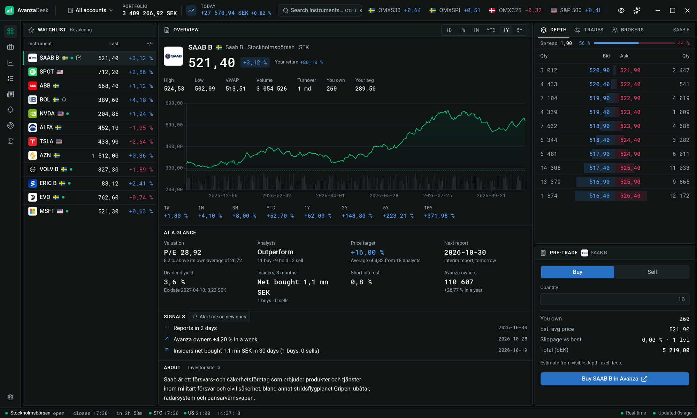
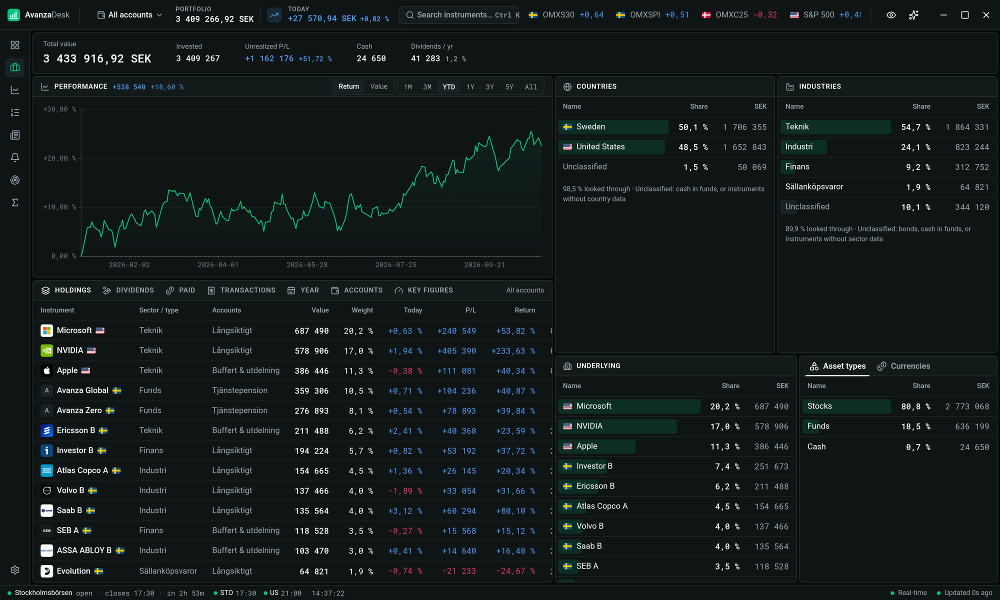
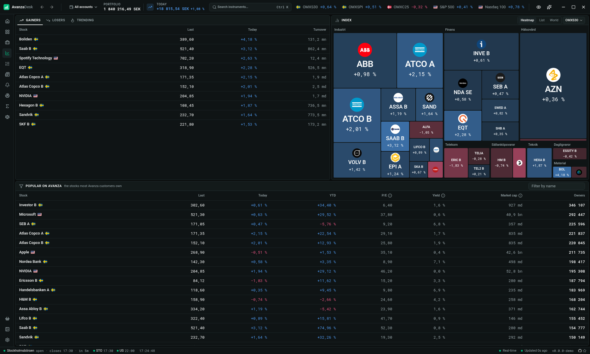
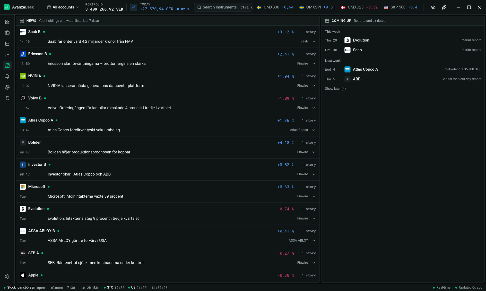
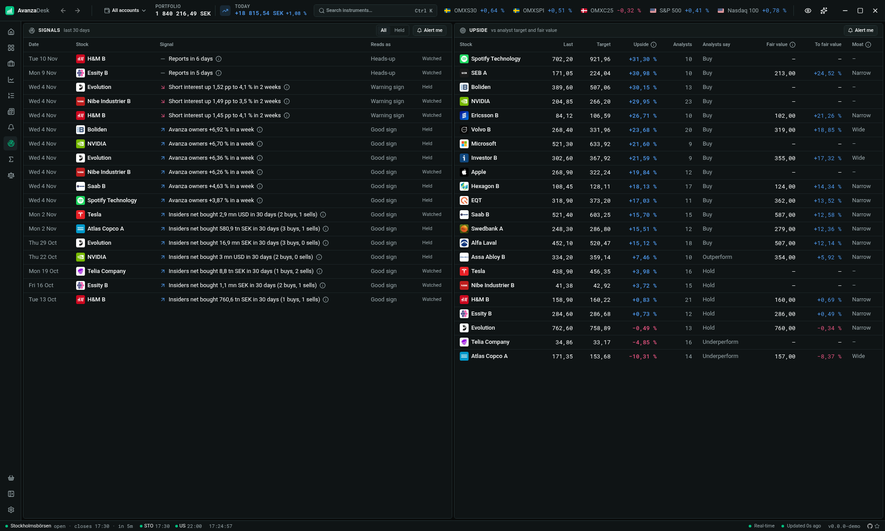
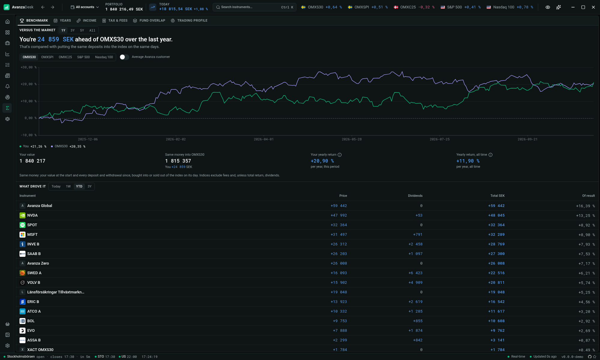
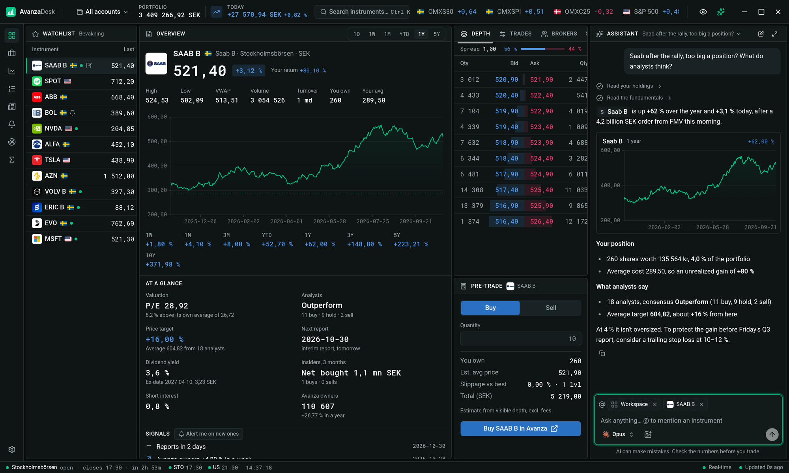

<div align="center">


# AvanzaDesk

**A fast, keyboard-first trading terminal for your Avanza account.**

[](https://github.com/AnteWall/avanza-desk/actions/workflows/ci.yml)
[](https://github.com/AnteWall/avanza-desk/releases/latest)

[](https://tauri.app)
[](https://react.dev)



</div>

---

## What it is

AvanzaDesk is a desktop app that turns your Avanza account into a Bloomberg-style terminal.
You sign in with BankID, and the app shows your holdings, watchlists, live prices, order books,
news and analysis side by side in resizable panels, and every page is one shortcut away.

It is built for people who keep Avanza open all day and want more data on screen with fewer clicks.

## Features

- **One workspace per stock.** Chart, order book, trade tape, brokers, company dossier, news and
  your notes side by side, in panels you can resize.
- **Pre-trade estimate.** Walks the visible order book to show the average price, slippage and how
  much of a market order would fill.
- **Custom alert rules.** Day moves, position weight, drift from target, short interest,
  loan-to-value and signals, with desktop notifications.
- **Signals.** What is happening in your holdings and watchlists, plus analyst upside to price targets.
- **Benchmark.** Your return against the index, and which holdings drove it.
- **Fund overlap.** Look through your funds to the companies, countries and sectors they hold, and
  see which funds double up.
- **Rebalancing.** Set target weights and get the exact trades, with a buy-only mode for new money.
- **Dividend forecast.** Expected income by month and by holding.
- **ISK tax and fees.** This year's ISK tax and the fees you paid.
- **AI assistant (optional).** Ask about your portfolio in plain language with Claude or Codex,
  using your own subscription. Read-only.
- **Keyboard first.** `Ctrl K` search, `Alt 1…8` pages, `1…6` chart ranges, `j`/`k` in tables.
- **Privacy mode.** Hide every amount with one click.

Also: portfolio and allocation, markets with index constituents, movers and a screener, orders,
stop losses and deals, and a news feed with a reports and dividends calendar.

## Screenshots

<table>
  <tr>
    <td width="50%"><p align="center"><b>Portfolio</b></p></td>
    <td width="50%"><p align="center"><b>Markets</b></p></td>
  </tr>
  <tr>
    <td><p align="center"><b>News</b></p></td>
    <td><p align="center"><b>Signals</b></p></td>
  </tr>
  <tr>
    <td><p align="center"><b>Analysis</b></p></td>
    <td><p align="center"><b>AI assistant</b></p></td>
  </tr>
</table>

## Your data stays on your computer

- **No servers of ours.** The app talks directly to Avanza. There is no AvanzaDesk backend, account or tracking.
- **No passwords.** You sign in with BankID. The app never sees or stores a password.
- **Session in your OS keychain.** The Avanza session is kept in the system keychain
  (macOS Keychain, Windows Credential Manager, Secret Service on Linux) and removed when you sign out.
- **Local storage only.** Settings, saved chats and portfolio history live in a local SQLite
  database on your machine.
- **The app does not place trades.** Trading happens in Avanza. AvanzaDesk only links you there.
- **The assistant is opt-in.** Nothing goes to an AI provider unless you connect one in Settings.
  It runs in a locked-down, read-only mode.

## Install

macOS and Linux:

```sh
curl -fsSL https://raw.githubusercontent.com/AnteWall/avanza-desk/main/scripts/install.sh | sh
```

Windows (PowerShell):

```powershell
irm https://raw.githubusercontent.com/AnteWall/avanza-desk/main/scripts/install.ps1 | iex
```

The app updates itself after that. Or download the latest build for your platform from
[Releases](https://github.com/AnteWall/avanza-desk/releases/latest):
`.dmg` for macOS (Apple silicon and Intel), `.msi`/`.exe` for Windows, `.AppImage`/`.deb`/`.rpm` for Linux.

## Build from source

Requirements: Node 24, pnpm, Rust stable and the [Tauri prerequisites](https://tauri.app/start/prerequisites/)
(or just `nix develop` with the included flake).

```sh
pnpm install
pnpm tauri dev     # run in development
pnpm tauri build   # build an installer
```

## Disclaimer

AvanzaDesk is an independent, unofficial project. It is **not affiliated with, endorsed by or
supported by Avanza Bank AB**. "Avanza" is a trademark of its owner. The app uses Avanza's
private APIs, which may change or break without notice.

Nothing in this app is investment advice. Data, estimates, alerts and AI answers may be delayed,
incomplete or wrong. Check them in Avanza before you act. **You use AvanzaDesk entirely at your own
risk**, and every trading decision and its outcome is yours.

The software is provided "as is", without warranty of any kind. The author is not responsible for
any direct or indirect damages (foreseeable or unforeseeable), including but not limited to
trading losses, missed alerts or notifications, loss of profits or opportunities, loss or
alteration of or fraudulent access to data, accidental transmission of viruses or any other
harmful element, the cost of replacement goods and services, or the attitude and behavior of a
third party.

## Built on

- [**avanza-ts**](https://github.com/AnteWall/avanza-ts): the TypeScript Avanza client that powers all the data in this app.
- [Tauri](https://tauri.app), [React](https://react.dev), [TanStack](https://tanstack.com),
  [shadcn/ui](https://ui.shadcn.com) and [Base UI](https://base-ui.com).

## Built with AI

Much of this app was written with AI coding assistants (Claude Code and Codex), reviewed and
directed by a human.

## License

[AGPL-3.0](LICENSE): free to use, share and modify. If you distribute a modified version, or run
one as a network service, you must publish its source under the same license.
